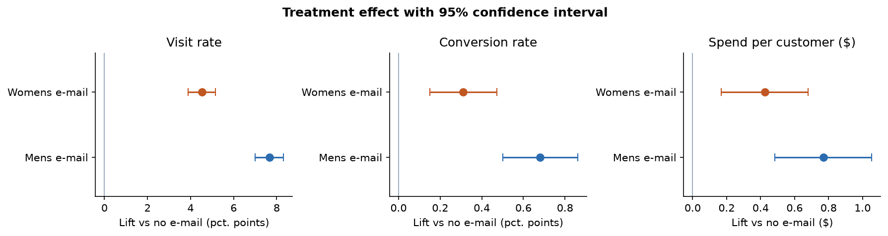
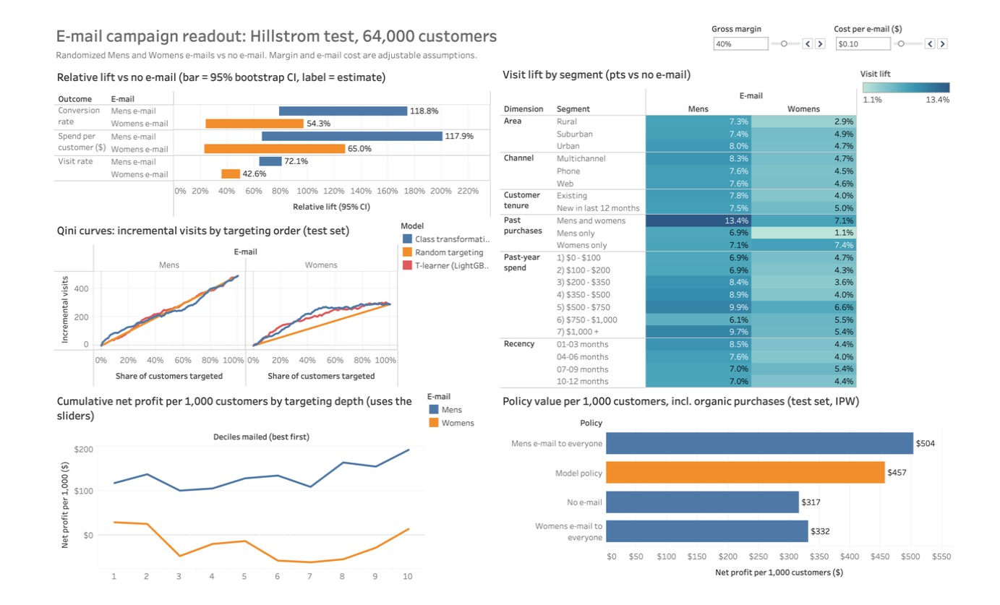

# E-mail Campaign A/B Test and Uplift Targeting

**Did two marketing e-mails make money, and who should get the next one?** A retailer randomly split
64,000 recent customers into three groups: a Mens merchandise e-mail, a Womens merchandise e-mail, and
no e-mail. This project measures the causal effect of each e-mail on visits, conversions and spend,
converts it into profit, and builds an uplift model to decide who to mail next time.

**Tools:** SQL (DuckDB) · Python (pandas, statsmodels, scikit-learn, LightGBM) · Statistics
(SRM, balance, Welch/z tests, bootstrap, Holm, CUPED, power) · Excel (P&L model) · Tableau (dashboard)



## Results

| Outcome | Control | Mens e-mail | Womens e-mail |
|---|---:|---:|---:|
| Visit rate | 10.62% | 18.28% (+7.66 pts, CI +7.00 pts to +8.32 pts) | 15.14% (+4.52 pts, CI +3.89 pts to +5.16 pts) |
| Conversion rate | 0.57% | 1.25% (+0.68 pts, CI +0.50 pts to +0.86 pts) | 0.88% (+0.31 pts, CI +0.15 pts to +0.47 pts) |
| Spend per customer ($) | $0.653 | $1.423 (+0.770, CI +0.485 to +1.055) | $1.077 (+0.424, CI +0.169 to +0.680) |

Values are treated-group levels with the absolute lift versus control and its 95% confidence interval.

1. **Randomization held.** Arm sizes 21,306 / 21,307 / 21,387 (sample-ratio test p = 0.90); largest covariate imbalance |SMD| = 0.014, under the 0.1 rule of thumb.
2. **Both e-mails lifted visits and spend.** Effects with a Holm-adjusted p-value below 0.05 across the 6 tests: Mens visit, Mens conversion, Mens spend, Womens visit, Womens conversion, Womens spend. Effects that do not pass the correction: none.
3. **The Mens e-mail earns more.** It added $0.770 of spend per customer (95% CI $0.485 to $1.055) against $0.424 for the Womens e-mail. At a 40% margin and $0.10 per e-mail that is $0.208 net per customer mailed, or $20,793 on a 100,000-customer list ($9,406 at the CI lower bound).
4. **Break-even cost.** The Mens e-mail stays profitable up to $0.308 per e-mail at this margin, 3.1 times the assumed cost.
5. **Targeting does not beat the best blanket send.** An uplift policy chosen on validation data and scored once on 19,200 held-out customers earns $457 per 1,000 customers, including purchases they would have made anyway (95% CI $307 to $627), versus $504 (95% CI $344 to $698) for 'Mens e-mail to everyone'. Mailing everyone is the better choice on this evidence.
6. **CUPED with past-year spend barely helps here** (variance reduction 0.4% for visits, 0.0% for spend).

**Recommendation.** Send the **Mens e-mail** next time: each e-mail returns 2.1 times its assumed cost in net profit. Skip uplift targeting for now: on held-out customers it earned less than mailing everyone the Mens e-mail. Revisit it once richer customer features are available.

## Deliverables

| Deliverable | Where |
|---|---|
| Tableau dashboard (open the packaged file in Tableau Desktop or Tableau Public) | `dashboards/tableau/campaign_readout.twbx` |
| Excel P&L model with inputs, targeting depth and sensitivity grid | `excel/campaign_pnl_model.xlsx` |
| Analysis notebook with outputs | `notebooks/campaign_analysis.ipynb` |
| One-page memo for the marketing lead | `reports/memo.md` |
| SQL used for loading, quality checks and segment aggregates | `sql/` |
| All result tables (CSV) and figures | `reports/tables/`, `reports/figures/` |



## How the analysis works

1. **Load and check** (`sql/01-02`): DuckDB reads the raw CSV, fixes the source typo `Surburban`, and runs
   hard rules (row count, nulls, valid flags) that stop the pipeline and soft rules logged in
   [`docs/data_quality_log.md`](docs/data_quality_log.md).
2. **Validate the randomization**: sample-ratio-mismatch chi-square test and standardized mean differences
   for every pre-treatment covariate.
3. **Estimate effects**: two-proportion tests for visit and conversion, Welch t-test for spend, bootstrap CIs
   for relative lifts, Holm correction across the six comparisons, CUPED and regression adjustment as
   variance-reduction checks, and minimum detectable effects at 80% power.
4. **Segment the lift** (`sql/05`): visit and spend lift with CIs by recency, past spend, channel, area,
   tenure and past purchase category.
5. **Model uplift**: a LightGBM T-learner and a class-transformation logistic model per e-mail, compared on
   Qini curves. The model choice and the targeting threshold are picked on a validation split; the
   test split is scored once with inverse propensity weighting (each arm had a 1/3 chance).
6. **Price the decision**: profit per customer, campaign profit, break-even cost and a sensitivity grid,
   in Python and as live formulas in Excel.

Details: [`docs/methodology.md`](docs/methodology.md) · data dictionary: [`docs/data_dictionary.md`](docs/data_dictionary.md)

## Run it

```bash
python -m venv .venv && source .venv/bin/activate
pip install -r requirements.txt
make all          # download data, run the pipeline, execute the notebook, run tests
```

Or step by step: `make data`, `make pipeline`, `make notebook`, `make test`. Results are reproducible
(seed 42); `reports/results.json` holds every number quoted above.

## Project structure

```
├── data/                 raw/ and processed/ (git-ignored), README with source and licence
├── sql/                  DuckDB SQL: load, quality checks, summaries, segment aggregates
├── src/                  pipeline code (data, experiment stats, uplift, figures, Excel, Tableau, report)
├── notebooks/            executed analysis notebook
├── excel/                campaign P&L model
├── dashboards/tableau/   packaged .twbx dashboard (Hyper extracts inside), CSV extracts, preview image
├── reports/              results.json, memo, figures, tables
├── docs/                 methodology, data dictionary, data quality log
└── tests/                pytest suite (data rules, statistics, uplift evaluation)
```

## Data

Kevin Hillstrom, *MineThatData E-Mail Analytics and Data Mining Challenge* (2008),
[blog post and data](https://blog.minethatdata.com/2008/03/minethatdata-e-mail-analytics-and-data.html).
The raw CSV is downloaded by `src/download_data.py` and is not stored in this repository.

## Assumptions and limits

* Gross margin (40%) and cost per e-mail ($0.10) are assumptions,
  not data; the Excel model and Tableau parameters let you change them.
* Outcomes cover two weeks after the send, so longer-term effects (unsubscribes, later purchases) are not measured.
* Spend is zero for most customers, so spend CIs are wide; bootstrap and Welch intervals agree closely.
* Segment results are exploratory (many comparisons); act on them only after a confirmatory test.
